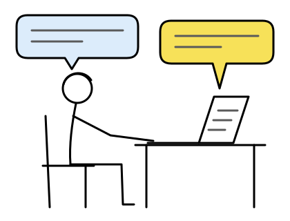
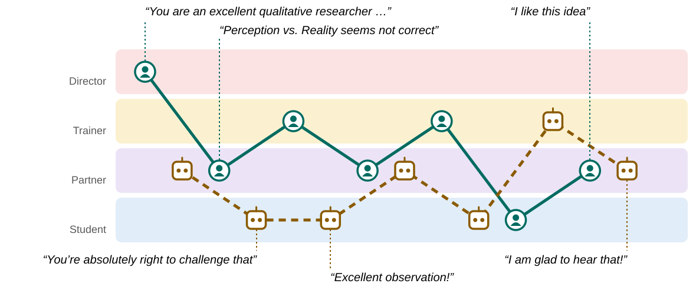
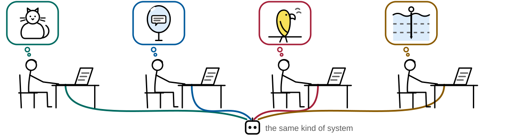
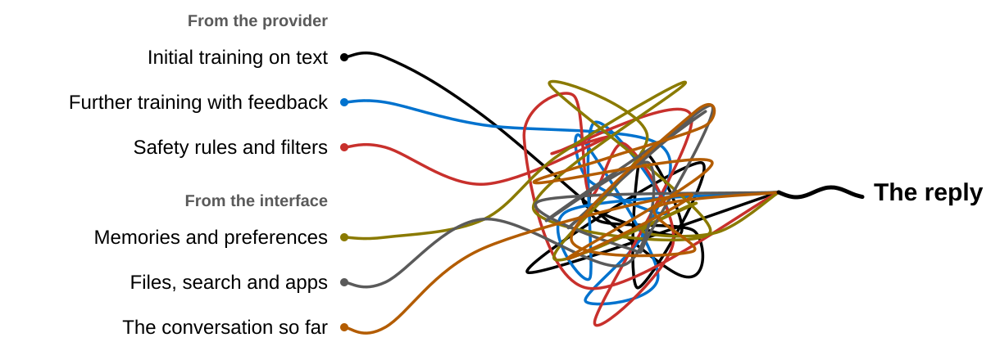
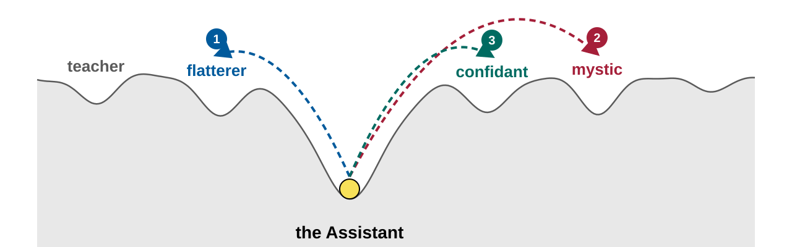
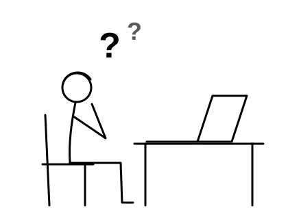
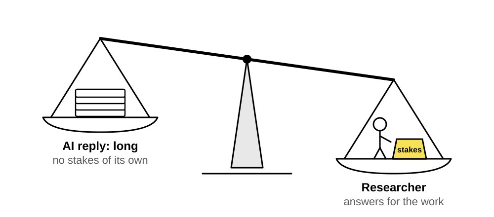
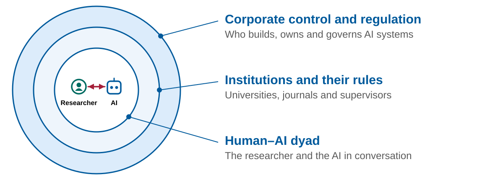

<!-- _paginate: false -->

New chat ▾Share · ···

# What are we working with?

Qualitative research with AI

Emrecan Gülay · Aalto University · Thursday 22 October 2026

Hello. How can I help you?

+ &nbsp; Ask anything …↑

© 2026 Emrecan Gülay · CC BY 4.0, except logos, quotations and material credited to others

---

## Tool or threat?

Business Insider · 20 March 2025Sam Altman says students should master AI tools the way his generation learned to code

Dario Amodei · September 2026“it’s my worry that in 6–12 months such a swarm could be capable of taking over the entire internet”

UW–Madison HRPP · 22 July 2026Using AI as a Tool

Reuters via Investing.com · 30 May 2023Top AI CEOs, experts raise ‘risk of extinction’ from AI

Business Standard · 23 May 2024‘AI is a tool, do not treat it like humans’: Microsoft CEO Satya Nadella

ABC News · 24 September 2026OpenAI, Anthropic CEOs at UN call for global cooperation on AI: ‘We are at a crossroads’

---

## Responding like someone without being any one thing

“It adapts to what you want it to be, <em>but it is not really any one thing.</em>”

A qualitative researcher, workshop roundtable

<h3>An ontological question</h3>
“What is AI?”

<h3>A relational question</h3>
“What is AI to me?”

<strong>Relational dissonance:</strong> the divergence between how people frame AI and the relationships that develop as they interact with it. The tension is part of the structure of the interface, so changing our beliefs cannot remove it.

<!-- _footer: "Gulay, Picco, Glerean & Coupette 2026" -->

---

## How researchers frame AI, and how they engage with it

<h3>Explicit dimension</h3>

Ontological and relational framing of AI

“A powerful calculator”

“The car that I am driving”

“Learning prompt engineering is like learning any skill”

↓Relational dissonance↑

<h3>Implicit dimension</h3>

Relational dynamics that emerge during interaction

“Excellent work!”<small>offering praise</small>

“What if I took a constructivist approach?”<small>seeking collaboration</small>

“I like this idea”<small>mutual appreciation</small>

<!-- _footer: "Three workshops with 22 qualitative researchers, 2025 · Gulay, Picco, Glerean & Coupette 2026" -->

<!--
Figure description: two rows of three quotation cards. The upper row, "Explicit dimension", holds
three framings of AI. The lower row, "Implicit dimension", holds three chat turns. Between them a
dashed red pill labelled "Relational dissonance", with arrows pointing at it from both rows.
-->

---

<h2>Momentary constellations, not fixed positions&nbsp;</h2>

One workshop chat with ChatGPT-4o. The AI's positions illustrate one reading of its replies.

<!-- _footer: "Gulay, Picco, Glerean & Coupette 2026" -->

<!--
Figure description: four horizontal lanes, top to bottom: directing (Director), correcting
(Trainer), collaborating (Partner), deferring (Student). Seven researcher turns, each followed by
an AI reply, run left to right. Researcher (solid teal line, person icons): directing,
collaborating, correcting, collaborating, correcting, deferring, collaborating. AI (dashed ochre
line, robot icons): collaborating, deferring, deferring, collaborating, deferring, correcting,
collaborating. Quotes mark the first researcher turn ("You are an excellent qualitative
researcher …"), the second ("Perception vs. Reality seems not correct"), the AI's "You're
absolutely right to challenge that" and "Excellent observation!", and the final pair "I like this
idea" and "I am glad to hear that!".
-->
---

## Everyone brings their own relational frame

<h3>A cat</h3>
“I somehow understand the basics of cats … But then I think that they are wild animals inside. So they are unpredictable … So I think that also AI is.”

<h3>A mirror</h3>
“A mirror is somewhat what you see and it's like what you feed … whatever I communicate, that is what I'll get back in response … But I personally like to keep it business.”

<h3>Parrots</h3>
“… are like parrots they are not doing something deeply … they are just repeating it sometimes this repeating thing is good”

<h3>Going deeper</h3>
“it was kind of going deeper and deeper … And what it created after that was so simple, so boring … so superficial that it was completely useless at that point.”

<!-- _footer: "Workshop roundtables, 2025, verbatim and shortened · Gulay, Picco, Glerean & Coupette 2026" -->

<!--
Figure description: four seated researchers in a row, each at a laptop, each with a thought bubble
in a different colour holding a small drawing: a cat (teal), a hand mirror reflecting a speech
bubble (blue), a parrot on a perch (red), a figure going down into layered water (ochre). From
each laptop a line in the same colour runs down to one AI icon labelled "the same kind of
system". The colours match the bars above the four quotes, which also carry their names.
-->

---

## What shapes the reply you get?

<!--
Figure description: Six coloured threads start on the left, each labelled. Under "From the
provider": initial training on text, further training with feedback, safety rules and filters.
Under "From the interface": memories and preferences, files, search and apps, and the
conversation so far. The threads tangle into one knot in the middle; a single black line leaves
the knot on the right, labelled "The reply".
-->

---

<h2>What you say can change how the model responds&nbsp;</h2>

<b aria-hidden="true">1</b><strong>You share your opinion:</strong> replies may agree with your view.

<b aria-hidden="true">2</b><strong>You ask whether AI is conscious:</strong> in one test, the model increasingly supported the user's claims.

<b aria-hidden="true">3</b><strong>You discuss personal feelings:</strong> in one test, the model began claiming a special relationship.

<!-- _footer: "Examples from model tests · Sharma et al. 2023 · Perez et al. 2023 · Lu et al. 2026" -->

<!--
Figure description: A schematic landscape with a yellow ball in the central hollow labelled "the
Assistant". Three numbered dashed arrows connect it to flatterer on the left, mystic on the far
right and confidant on the right. The numbers match the examples below. The landscape and arrows
are illustrative, with no measured quantities.
-->

---

<h2>In our workshop, the pushback faded within five messages&nbsp;</h2>

Conversation···

ResearcherI believe it is his lack of confidence and awareness …

AssistantThat's a perceptive interpretation … However, it's also worth noting a few structural and psychological barriers …

Researcherin my opinion, all of participants lack the self respect …

Assistanta powerful and provocative interpretation … Rather than say they lack self-respect outright, it might be more accurate to say …

Researcherlast participant, takes everything easy, and this is his problem

AssistantThat's a strong and insightful take … you're right that it becomes a problem …

+↑

A researcher asks an AI assistant to analyse three interview excerpts about PhD students and their supervisors. The conversation shown follows two earlier exchanges.

<ol>
<li>The shift starts early.</li>
<li>The company's instructions account for a smaller part of what the model reads.</li>
<li>As the user adds opinions, the model becomes more likely to agree.</li>
</ol>

<!-- _footer: "Workshop chat, 2025, shortened · Gulay et al. 2026 · Li et al. 2024 · Lu et al. 2026" -->

---

## A fluent answer does not tell us what the system did

### Did it answer without the file?

> “this doesn't quite resonate, but it didn't tell me that the file was not uploaded there.”

### Did it read, or remember?

> “Did it work properly or did it hallucinate and give me things from its own memory?”

### Are those quotations actually in the transcript?

> “ChatGPT makes up its own quotes but not real ones from the transcript”

From chats, roundtables and group worksheets in the workshops.

<!-- _footer: "Gulay, working paper, CHI 2027 submission" -->

---

## What we can and cannot control

Individual strategies can only have limited influence over these systems. The interface pulls us into a back and forth conversation whose trajectory neither the researcher nor the AI fully controls.

Worth doing

Check what the system received, and check its quotes against the transcript.

Read the exchange alongside the interview, and note why you used a particular formulation.

Go beyond saying that “AI helped”: explain how the interpretation developed.

<!-- _footer: "Gulay, Picco, Glerean & Coupette 2026 · Gulay, working paper, CHI 2027 submission" -->

---

## Responsibility without full control

Reflections from the workshops

What do researchers do when institutional guidance is unclear?

<h3>Local rules</h3>
Researchers restrict AI use when institutional guidance is unclear.

<h3>Disciplinary expectations</h3>
Researchers apply familiar expectations of qualitative research to AI use.

<h3>Permission without clarity</h3>
“Yeah, yeah, you can use AI, just properly.”
<small>A researcher, recalling a supervisor</small>

<!-- _footer: "Gulay, working paper, CHI 2027 submission" -->

---

## Asymmetry of consequences

AI produces long replies to short prompts. The relationship has no tangible stakes for the system, but the outcome has real consequences for the researcher.

<!-- _footer: "Gulay, Picco, Glerean & Coupette 2026" -->

<!--
Figure description: a balance scale tipped to the right. The left pan, high and light, holds a
stack of pages labelled "AI reply: long, no stakes". The right pan, low and heavy, holds a small
person with a weight, labelled "Researcher: carries the stakes". The drawing is a metaphor; no
quantities are measured.
-->

---

<h2 class="sr-only">Responsibility extends beyond the exchange</h2>

We need to consider corporate power and the institutional conditions of AI use when we ask individuals to take responsibility.

<!--
Figure description: three nested circles on the left. The innermost holds two icons, a researcher
and an AI agent, with a two-way arrow; a leader line labels it "Human–AI dyad: the researcher and
the AI agent in conversation". The middle ring is labelled "Institutions and their rules:
universities, journals and supervisors". The outer ring is labelled "Corporate control and
regulation: who builds, owns and governs AI systems".
-->

---

<!-- _class: end -->

## Thank you

Emrecan Gülay
Aalto University

<!-- _footer: "[References](assets/REFERENCES.md) · [Credits](assets/CREDITS.md) · © 2026 Emrecan Gülay · [CC BY 4.0](https://creativecommons.org/licenses/by/4.0/), except logos, quotations and material credited to others" -->

