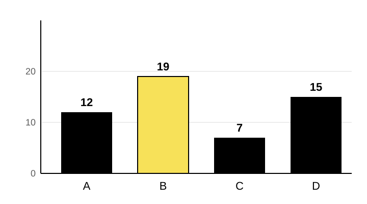
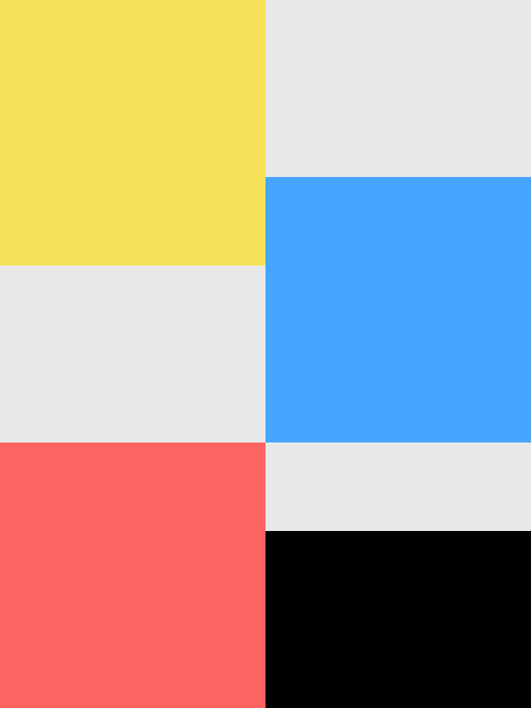

<!-- _class: title -->

# Aalto Marp layout gallery

Every layout in the theme, with notes on when to use it

Data Agents Presentations · reference deck

<!-- _footer: "© 2026 Emrecan Gülay · CC BY 4.0, except logos, quotations and material credited to others" -->

<!--
Layout: title (directive `_class: title`). Then # Title, a subtitle paragraph and an
author/date paragraph.
The author line sits at the bottom of the slide.
-->

---

<!-- _class: agenda -->

## Agenda layout

1. Text and columns
2. Process and boxes
3. Figures, pictures and tables
4. Quotes, statements and sections

<!--
Layout: agenda. A numbered Markdown list after a ## heading.
-->

---

## Text slide: the title states the point

- Default layout: `##` title and up to about five lines
- Use **bold** for the one phrase people should remember
- Nested points are smaller
  - Keep nesting to one level
- Sources go in the footer directive

<!-- _footer: "Source: put citations and image credits here with the footer directive." -->

<!--
Layout: default (no class). Add a `_footer` directive comment for sources.
-->

---

## Two columns

<div class="columns">
<div>

### Left column

Markdown works inside the columns when a blank line follows each `<div>`.

</div>
<div>

### Right column

- Use `columns left-wide` or `columns right-wide` for a 2:1 split
- Three `<div>`s give three columns

</div>
</div>

<!--
Layout: columns. Wrap each column in <div>...</div> inside <div class="columns">.
Leave a blank line after each opening <div> and before each closing </div>.
-->

---

<!-- _class: blue -->

## Process diagram on a blue slide

<ol class="process">
<li><strong>Collect the material</strong> Interviews, field notes, logs</li>
<li><strong>Read with the agent</strong> Check each suggestion against the passage</li>
<li><strong>Write the account</strong> Record decisions and open questions</li>
</ol>

Process diagrams are real text: screen readers announce a list of three steps.

<!--
Layout: process. Use <ol class="process"> with one <li> per step and the step name in
<strong>. Prefer this over a picture of a diagram: it needs no alt text and stays editable.
Colour variants: blue, red, yellow, black. Text on coloured slides stays black.
-->

---

<!-- _class: red -->

## Boxes on a red slide

<div class="columns">
<div class="box white">

### White box

Use boxes to group a short point.

</div>
<div class="box yellow">

### Yellow box

Highlight one box at most.

</div>
<div class="box outline">

### Outline box

For secondary content.

</div>
</div>

<!--
Layout: box. Classes: box, box white, box yellow, box outline.
Colour carries no meaning on its own: say in words which box matters.
-->

---

## Figure with a caption

<div class="columns left-wide">
<div>

<figure>



<figcaption>Figure 1. Example data, count per category. Category B is highlighted.</figcaption>
</figure>

</div>
<div>

### How alt text works

Alt text says what the figure shows and why it is here.

The full data goes in the notes as a figure description.

</div>
</div>

<!--
Layout: figure. Short alt text in , visible caption in <figcaption>.

Figure description: Bar chart with four categories on the horizontal axis and counts from
0 to 20 on the vertical axis. A = 12, B = 19 (highlighted in yellow), C = 7, D = 15.
B is the largest category and C the smallest.
-->

---

## Free-form visual drawn in the slide

<style scoped>
.trend { width: 760px; height: auto; }
.trend .axis { stroke: var(--aalto-black); stroke-width: 2; }
.trend .grid { stroke: var(--aalto-grey-light); }
.trend .a { stroke: var(--chart-1); fill: none; stroke-width: 5; }
.trend .b { stroke: var(--chart-2); fill: none; stroke-width: 5; stroke-dasharray: 14 8; }
.trend text { font-size: 22px; fill: var(--aalto-black); }
.trend .label-a { fill: var(--chart-1); font-weight: 700; }
.trend .label-b { fill: var(--chart-2); font-weight: 700; }
</style>

<div class="columns left-wide">
<div>

<svg class="trend" viewBox="0 0 760 380" role="img" aria-label="Line chart of example data over four weeks: series A rises from 10 to 30 while series B stays near 15.">
  <line class="grid" x1="60" y1="60" x2="600" y2="60"/>
  <line class="grid" x1="60" y1="180" x2="600" y2="180"/>
  <line class="axis" x1="60" y1="300" x2="600" y2="300"/>
  <line class="axis" x1="60" y1="40" x2="60" y2="300"/>
  <text x="48" y="308" text-anchor="end">0</text>
  <text x="48" y="188" text-anchor="end">15</text>
  <text x="48" y="68" text-anchor="end">30</text>
  <text x="110" y="336" text-anchor="middle">Week 1</text>
  <text x="280" y="336" text-anchor="middle">Week 2</text>
  <text x="450" y="336" text-anchor="middle">Week 3</text>
  <text x="590" y="336" text-anchor="middle">Week 4</text>
  <polyline class="a" points="110,220 280,160 450,110 590,60"/>
  <polyline class="b" points="110,180 280,170 450,190 590,175"/>
  <text class="label-a" x="610" y="68">A (solid)</text>
  <text class="label-b" x="610" y="182">B (dashed)</text>
</svg>

</div>
<div>

### Any form that fits

Charts and diagrams can depart from the Aalto template.

Here: inline SVG, scoped styles, chart colours, direct labels and line styles so colour is not the only cue.

</div>
</div>

<!--
Layout: free-form visual. A `style scoped` block styles only this slide; use your own class
names and the --chart-* colours. The svg element carries role="img" and an aria-label.

Figure description: Example data, not research results. Line chart over weeks 1 to 4,
vertical axis 0 to 30. Series A (solid blue line) rises steadily: about 10, 18, 24 and 30.
Series B (dashed red line) stays roughly flat: about 15, 16, 14 and 16.
-->

---

## Picture slide



- `` puts a picture on the right
- Words after the keywords become the alt text
- Keep pictures on the right so the logo stays clear

<!--
Layout: picture. Keywords bg, right, 40% are read by Marp; the rest of the bracket text
is the description. Use `bg left:40%` only when the picture must be on the left.
-->

---

## Table

| Format | Use it for | Screen readers |
| --- | --- | --- |
| HTML | Presenting and sharing | Full support, with notes |
| PDF | Handouts and archiving | Text and bookmarks |
| PPTX | Only if someone requires it | Not readable (slides are pictures) |

<!--
Layout: table. Keep a header row; it is announced with each cell.
-->

---

<!-- _class: quote -->

<h2 class="sr-only">Participant quote</h2>

> “Quote participants’ exact words, including hesitations and repairs.”
>
> Attribution line: participant code and context, e.g. P07, workshop 2

<!--
Layout: quote. The heading is hidden visually but lets screen-reader users navigate.
Keep quotations verbatim and give their context.
-->

---

<!-- _class: black section-header -->

## Section header on black

A short line about what this part covers

<!--
Layout: section-header. Combine with black, blue, red or yellow.
-->

---

<!-- _class: yellow statement -->

<h2 class="sr-only">Statement</h2>

One sentence that you want the room to remember.

<!--
Layout: statement. One paragraph, at most two lines.
-->

---

## Code and inline code

Run `start.bat` and choose **Build**, or:

```bash
npm run build -- "decks/2026-11-03 Example deck"
```

<!--
Layout: code. Fenced code blocks wrap long lines.
-->

---

<!-- _class: end -->

## Thank you

Emrecan Gülay
Aalto University
